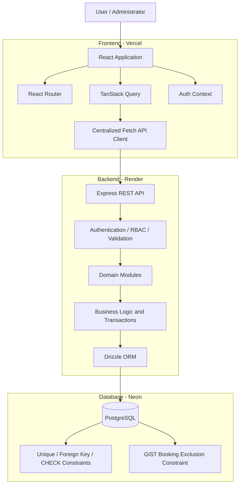
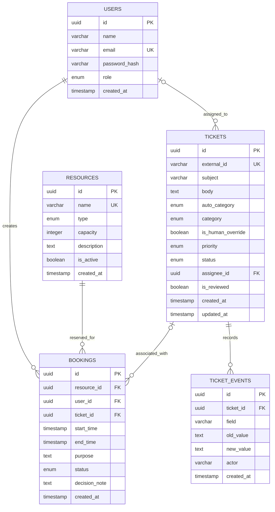

# TriageSync

### Intelligent Ticket Triage · Auditable Workflows · Race-Safe Resource Booking

TriageSync is a full-stack support ticket triage and internal resource scheduling platform built for the **ENGN-F1 Full Stack Developer Assessment**.

It automates incoming ticket classification and priority assignment, supports human agent review, maintains an immutable audit history, and provides concurrency-safe booking for shared resources such as meeting rooms, laboratories, and diagnostic equipment.

The application combines a React frontend, an Express REST API, and PostgreSQL database constraints to ensure that business rules remain enforceable even under concurrent requests.

---

## Live Demo

| Component | Link |
|---|---|
| Frontend Application | `https://engnf1-fullstack-sambaran-banerjee.vercel.app/` |
| Backend API | `https://engnf1-fullstack-sambaranbanerjee.onrender.com/` |
| API Health Check | `https://engnf1-fullstack-sambaranbanerjee.onrender.com/health` |
| GitHub Repository | [TriageSync](https://github.com/SambaranBanerjee/engnf1-fullstack-SambaranBanerjee) |


---

## Table of Contents

- [Overview](#overview)
- [Key Features](#key-features)
- [Technology Stack](#technology-stack)
- [System Architecture](#system-architecture)
- [Project Structure](#project-structure)
- [Database Design](#database-design)
- [Core Engineering Decisions](#core-engineering-decisions)
- [API Reference](#api-reference)
- [Getting Started](#getting-started)
- [Seeded Demo Data](#seeded-demo-data)
- [Testing](#testing)
- [Security](#security)
- [Known Limitations](#known-limitations)
- [Documentation](#documentation)

---

## Overview

Support teams regularly handle incoming tickets that require categorization, prioritization, assignment, and human review. They may also need to reserve shared internal resources to investigate or resolve issues.

TriageSync brings these workflows together in one application.

The platform provides:

1. **Automated triage:** Incoming tickets are classified using deterministic keyword and phrase matching.
2. **Human-in-the-loop review:** Agents can correct automated classifications without losing the original prediction.
3. **Auditability:** Ticket modifications are recorded as events, preserving a history of operational changes.
4. **Resource scheduling:** Users can discover resource availability and request bookings.
5. **Concurrency safety:** PostgreSQL prevents overlapping active bookings, even when multiple requests arrive simultaneously.
6. **Administrative analytics:** Administrators can monitor ticket distributions, booking activity, and resource utilization.

The application follows a **modular monolith architecture**. Frontend features, backend domain modules, and database responsibilities are separated without introducing the operational complexity of microservices.

---

## Key Features

### 1. Authentication and Role-Based Access Control

- User registration and login.
- Argon2id password hashing.
- JWT-based authentication with 12-hour access-token expiry.
- Two application roles: `USER` and `ADMIN`.
- Middleware-based authentication and role authorization.
- Service-level ownership checks for protected operations.
- In-memory frontend token storage.

Public registration creates `USER` accounts. Administrator accounts are provisioned through the database seed process.

### 2. Automated Ticket Classification

Incoming tickets are classified using a deterministic rule-based engine.

**Supported categories**

| Category | Example matching terms |
|---|---|
| `BILLING` | refund, invoice, charge, payment |
| `LOGIN` | password, 2FA, sign in, locked out, login |
| `DELIVERY` | package, shipping, tracking, delivery |
| `BUG` | crash, error, 500, exception, broken |
| `FEATURE_REQUEST` | Default category when no category rule matches |

**Priority assignment**

| Priority | Example matching terms |
|---|---|
| `URGENT` | urgent, production down, locked out |
| `HIGH` | error, refund, not arrived |
| `MEDIUM` | Default priority |

The classifier uses normalized text and explicit matching rules, making its output reproducible and straightforward to audit.

### 3. Idempotent Ticket Import

Ticket ingestion is designed to handle repeated imports safely.

- Every imported ticket has a unique `externalId`.
- PostgreSQL enforces uniqueness.
- Conflict-aware inserts prevent duplicate records.
- Existing ticket information can be refreshed during re-import.
- Human-modified classifications are protected.

The system distinguishes between:

- `autoCategory`: Original automated classification.
- `category`: Current operational classification.
- `isHumanOverride`: Indicates whether an agent has manually overridden the classification.

When a ticket has a human override, subsequent imports preserve the manually selected category rather than replacing it with a new classifier result.

### 4. Transactional Audit History

Ticket updates and their corresponding audit events are written within a single database transaction.

For example, when an administrator changes a ticket's priority:

1. The previous value is retrieved.
2. The ticket is updated.
3. A corresponding `ticket_events` record is inserted.
4. Both operations are committed together.

If either operation fails, the transaction rolls back.

This prevents the application from recording an update without its corresponding audit event.

### 5. Resource Management

Administrators can:

- Create resources.
- Update resource details.
- Activate or deactivate resources.
- View resource information.

Supported resource types:

- `ROOM`
- `LAB`
- `EQUIPMENT`

Users can browse active resources and inspect their availability over a maximum seven-day window.

### 6. Race-Safe Booking System

Booking concurrency is one of TriageSync's central engineering concerns.

The application enforces:

- 30-minute UTC booking-grid validation.
- Valid start and end times.
- No overlapping active bookings for the same resource.
- A maximum of three active future bookings per user.
- Ownership-based cancellation.
- Administrator approval and rejection.
- Valid booking state transitions.

**Database-level overlap protection**

PostgreSQL uses a GiST exclusion constraint with `tstzrange` and the `btree_gist` extension.

The constraint prevents overlapping intervals for the same resource when the booking status is `PENDING` or `APPROVED`.

Intervals use half-open boundaries (`[start, end)`), allowing consecutive bookings without treating them as overlapping.

When PostgreSQL detects an exclusion violation, the backend translates SQLSTATE `23P01` into an HTTP `409 Conflict` response.

**Concurrent request guarantee**

For ten or more simultaneous requests attempting to reserve the same resource and time interval:

- Exactly one request should successfully create a booking.
- The remaining requests should receive `409 Conflict`.
- Only one active overlapping booking should exist in PostgreSQL.

**Per-user booking limit**

The application uses a database transaction and `SELECT ... FOR UPDATE` on the requesting user's row before checking the active booking count.

This serializes concurrent booking creation attempts by the same user, preventing them from bypassing the three-booking limit.

### 7. Booking Lifecycle

Bookings follow an explicit service-layer state machine.

| Current Status | Action | Next Status | Authorized Role |
|---|---|---|---|
| `PENDING` | Approve | `APPROVED` | ADMIN |
| `PENDING` | Reject | `REJECTED` | ADMIN |
| `PENDING` | Cancel | `CANCELLED` | Owner |
| `APPROVED` | Cancel | `CANCELLED` | Owner |

Invalid transitions return `409 Conflict`.

Approval, rejection, and cancellation are restricted to bookings whose start time is still in the future. Rejection requires a decision note.

### 8. Ticket Search and Filtering

- Case-insensitive partial text search using PostgreSQL `ILIKE`.
- Combined filters using AND conditions.
- Pagination with configurable page size.
- Parameterized database queries.
- Whitelisted sorting fields.
- Stable sorting for predictable pagination.

### 9. Optimistic Ticket Updates

The frontend uses TanStack Query to provide responsive ticket updates.

The optimistic update lifecycle:

1. Cancel relevant in-flight queries.
2. Save a snapshot of the existing cache.
3. Apply the proposed change immediately.
4. Restore the snapshot if the API request fails.
5. Invalidate affected queries and reconcile with the server response.

This keeps the interface responsive without treating the frontend as the source of truth.

### 10. Administrative Analytics

Administrators can monitor:

- Ticket counts by category.
- Ticket counts by priority.
- Ticket counts by status.
- Reviewed ticket count.
- Model agreement rate.
- Active resource count.
- Booking status distribution.
- Top three resources.

Analytics are calculated by the backend and presented using Recharts.

---

## Technology Stack

| Layer | Technology | Purpose |
|---|---|---|
| Frontend | React 19 | Component-based UI |
| Build Tool | Vite | Development server and production builds |
| Language | TypeScript | Static type checking |
| Routing | React Router | Client-side navigation |
| Server State | TanStack Query | API caching and mutations |
| Forms | React Hook Form | Form state and submission |
| Validation | Zod | Runtime schema validation |
| Styling | Tailwind CSS | Responsive UI styling |
| Charts | Recharts | Administrative analytics |
| HTTP Client | Native Fetch API | Frontend API communication |
| Backend | Node.js + Express | REST API |
| Language | TypeScript | Backend type checking |
| ORM | Drizzle ORM | Database queries and schema definitions |
| Migrations | Drizzle Kit | Database migration management |
| Validation | Zod | Request validation |
| Password Security | Argon2id | Password hashing |
| Authentication | JSON Web Tokens | Stateless access-token authentication |
| Security | Helmet, express-rate-limit | HTTP security headers and rate limiting |
| Database | PostgreSQL | Persistent relational storage |
| Database Hosting | Neon | Managed PostgreSQL |
| Backend Hosting | Render | Express API deployment |
| Frontend Hosting | Vercel | Static frontend deployment |
| Testing | Vitest + Supertest | Unit and API testing |

---

## System Architecture

TriageSync follows a modular monolith architecture with three independently deployed components.



### Backend Request Flow

```text
HTTP Request
    |
    v
Express Router
    |
    v
Authentication Middleware
    |
    v
Role Authorization Middleware
    |
    v
Request Validation
    |
    v
Controller
    |
    v
Service Layer
    |
    v
Drizzle ORM / Custom SQL
    |
    v
PostgreSQL
    |
    v
Centralized Error Handling
    |
    v
HTTP Response
```

### Architectural Responsibilities

**Frontend**

Responsible for rendering, navigation, form interaction, local authentication state, server-state caching, and user feedback.

**Backend**

Responsible for authentication, authorization, request validation, business rules, transaction coordination, and API responses.

**PostgreSQL**

Responsible for persistent data, relational integrity, uniqueness, booking overlap prevention, and transactional consistency.

Security-sensitive rules are enforced by the backend and database rather than relying on frontend restrictions.

---

## Project Structure

```text
engnf1-fullstack-SambaranBanerjee/
│
├── backend/
│   ├── src/
│   │   ├── config/
│   │   │
│   │   ├── database/
│   │   │   ├── migrations/
│   │   │   ├── schema/
│   │   │   ├── connection.ts
│   │   │   └── seed.ts
│   │   │
│   │   ├── errors/
│   │   ├── middleware/
│   │   │
│   │   ├── modules/
│   │   │   ├── analytics/
│   │   │   ├── auth/
│   │   │   ├── bookings/
│   │   │   ├── resources/
│   │   │   └── tickets/
│   │   │
│   │   ├── utils/
│   │   ├── app.ts
│   │   └── server.ts
│   │
│   ├── tests/
│   │   ├── concurrency/
│   │   └── setup/
│   │
│   ├── drizzle.config.ts
│   ├── vitest.config.ts
│   └── package.json
│
├── frontend/
│   ├── src/
│   │   ├── app/
│   │   ├── components/
│   │   ├── context/
│   │   ├── features/
│   │   │   ├── auth/
│   │   │   ├── tickets/
│   │   │   ├── resources/
│   │   │   ├── bookings/
│   │   │   └── analytics/
│   │   │
│   │   ├── services/
│   │   ├── types/
│   │   └── utils/
│   │
│   ├── vercel.json
│   └── package.json
│
├── .env.example
├── .gitignore
├── README.md
├── SOLUTION.md
└── AI_USAGE.md
```

---

## Database Design

TriageSync uses five core PostgreSQL tables.

### Entity Overview



### Important Database Constraints

| Constraint | Purpose |
|---|---|
| Unique case-insensitive user email | Prevent duplicate accounts |
| Unique ticket `external_id` | Guarantee idempotent imports |
| Unique case-insensitive resource name | Prevent duplicate resource names |
| Foreign keys | Maintain relational integrity |
| Capacity CHECK constraint | Restrict capacity to 1–500 |
| Booking time CHECK constraint | Require `end_time > start_time` |
| GiST exclusion constraint | Prevent overlapping active bookings |
| User-row locking | Enforce the three-active-booking limit under concurrency |

### Booking Overlap Logic

Two intervals overlap when:

```text
newStart < existingEnd
AND
newEnd > existingStart
```

The database exclusion constraint enforces this rule atomically for active bookings.

---

## Core Engineering Decisions

### Why PostgreSQL?

PostgreSQL provides relational integrity, transactions, advanced indexing, and database-level constraints.

It is particularly useful for TriageSync because booking correctness must be preserved under concurrent requests. Application-level availability checks alone cannot guarantee this.

### Why a Modular Monolith?

The application has several distinct domains, but they share one deployment and relational database.

A modular monolith provides clear boundaries without requiring inter-service communication, distributed transactions, or additional infrastructure.

### Why Drizzle ORM?

Drizzle provides TypeScript-friendly schema definitions and typed query construction.

Custom SQL migrations are retained for PostgreSQL-specific features such as the GiST exclusion constraint.

### Why Argon2id?

Argon2id is a memory-hard password hashing algorithm. It increases the computational and memory cost of offline password cracking compared with fast general-purpose hashes.

### Why Database-Level Booking Protection?

A check-then-insert approach can fail when concurrent requests observe the same available slot.

The PostgreSQL exclusion constraint provides the final integrity guarantee independently of how many API instances are running.

### Why TanStack Query?

Ticket, resource, booking, and analytics data are server state. TanStack Query manages their caching, loading states, mutations, invalidation, and optimistic updates without mixing them into local UI state.

---

## API Reference

All endpoints use the `/api` prefix.

### Standard Error Format

```json
{
  "error": {
    "code": "BOOKING_CONFLICT",
    "message": "The requested resource slot is unavailable."
  }
}
```

### Authentication

| Method | Endpoint | Access | Description |
|---|---|---|---|
| POST | `/api/auth/register` | Public | Register a USER account |
| POST | `/api/auth/login` | Public | Authenticate and issue JWT |
| GET | `/api/auth/me` | Logged in | Retrieve authenticated user |

### Tickets

| Method | Endpoint | Access | Description |
|---|---|---|---|
| POST | `/api/tickets/import` | Logged in | Idempotent batch import |
| GET | `/api/tickets` | Logged in | Paginated queue with filters |
| GET | `/api/tickets/:id` | Logged in | Ticket details and audit history |
| PATCH | `/api/tickets/:id` | Logged in | Update ticket and record audit event |
| GET | `/api/stats` | Logged in | Ticket statistics |

### Resources

| Method | Endpoint | Access | Description |
|---|---|---|---|
| GET | `/api/resources` | Logged in | Paginated resource list |
| GET | `/api/resources/:id` | Logged in | Resource details |
| POST | `/api/resources` | ADMIN | Create resource |
| PATCH | `/api/resources/:id` | ADMIN | Update resource |
| GET | `/api/resources/:id/availability` | Logged in | Retrieve occupied intervals |

### Bookings

| Method | Endpoint | Access | Description |
|---|---|---|---|
| POST | `/api/bookings` | Logged in | Create a booking |
| GET | `/api/bookings/mine` | Logged in | List current user's bookings |
| GET | `/api/bookings/:id` | Owner / ADMIN | Retrieve booking |
| GET | `/api/bookings` | ADMIN | List all bookings |
| PATCH | `/api/bookings/:id/cancel` | Owner | Cancel booking |
| PATCH | `/api/bookings/:id/approve` | ADMIN | Approve booking |
| PATCH | `/api/bookings/:id/reject` | ADMIN | Reject booking |

### Administration

| Method | Endpoint | Access | Description |
|---|---|---|---|
| GET | `/api/admin/stats` | ADMIN | Administrative statistics |

---

## Getting Started

### Prerequisites

- Node.js 20 or later.
- npm.
- A Neon PostgreSQL project with a main database branch and an isolated test branch.
- Git.

### 1. Clone the Repository

```bash
git clone https://github.com/SambaranBanerjee/engnf1-fullstack-SambaranBanerjee.git

cd engnf1-fullstack-SambaranBanerjee
```

### 2. Configure Environment Variables

Create `backend/.env` using the root `.env.example` as a reference.

```env
NODE_ENV=development
PORT=4000

DATABASE_URL=<neon-main-pooled-url>
DIRECT_DATABASE_URL=<neon-main-direct-url>
TEST_DATABASE_URL=<neon-test-pooled-url>

JWT_SECRET=<random-secret-at-least-32-characters>

FRONTEND_ORIGIN=http://localhost:5173

ADMIN_PASSWORD=<your-admin-password>
```

**Environment variable notes**

| Variable | Purpose |
|---|---|
| `DATABASE_URL` | Pooled Neon connection for application queries |
| `DIRECT_DATABASE_URL` | Direct connection for migrations |
| `TEST_DATABASE_URL` | Isolated test database connection |
| `JWT_SECRET` | Signs and verifies access tokens |
| `FRONTEND_ORIGIN` | Allowed frontend origin for CORS |
| `ADMIN_PASSWORD` | Password used by the seed process for the administrator account |

Never commit real environment files, database credentials, or JWT secrets.

### 3. Install Backend Dependencies

```bash
cd backend
npm install
```

### 4. Run Database Migrations

```bash
npm run db:migrate
```

### 5. Seed the Database

```bash
npm run db:seed
```

The seed process provisions the administrator account, demo users, resources, and sample tickets.

It is designed to be idempotent: running it repeatedly should not create duplicate records or overwrite human ticket overrides.

### 6. Start the Backend

```bash
npm run dev
```

The API runs at:

```text
http://localhost:4000
```

### 7. Start the Frontend

Open another terminal:

```bash
cd frontend
```

Create `frontend/.env`:

```env
VITE_API_BASE_URL=http://localhost:4000/api
```

Install dependencies and start Vite:

```bash
npm install
npm run dev
```

The frontend is available at:

```text
http://localhost:5173
```

---

## Seeded Demo Data

The seed process provisions demo accounts, six resources, and fifteen sample tickets.

### Demo Accounts

| Role | Email | Password |
|---|---|---|
| ADMIN | `admin@triagesync.test` | `Admin@123` |
| USER | `user@triagesync.test` | `User@123` |

> **Security:** These are development/demo credentials only. Do not use these passwords in production. Configure a strong `ADMIN_PASSWORD` before running the seed process in a deployed environment.

### Seeded Resources

- War Room Alpha
- Escalation Pod B
- Hardware & Device Lab
- Legacy Staging Sandbox (inactive)
- Network Packet Analyzer Kit
- 4K Thermal & Oscilloscope Rig

### Seeded Tickets

Fifteen sample tickets cover all five categories and four priority levels.

The sample data includes:

- Four pre-reviewed tickets.
- A ticket containing raw HTML/script payload content (`SEED-1005`) for checking safe text rendering.

---

## Testing

TriageSync uses Vitest and Supertest, with integration and concurrency tests running against real PostgreSQL.

### Run Tests

Ensure migrations have been applied to the isolated test database, then run:

```bash
cd backend
npm test
```

### Critical Concurrency Test

The booking concurrency test verifies that multiple simultaneous requests cannot reserve the same resource and interval.

**Test procedure**

1. Create a resource with an available time slot.
2. Submit ten or more concurrent booking requests for that same slot.
3. Verify exactly one request returns `201 Created`.
4. Verify all remaining requests return `409 Conflict`.
5. Verify PostgreSQL contains only one active overlapping booking.

### Additional Important Test Scenarios

- Re-importing an existing ticket does not create duplicates.
- Human ticket overrides survive subsequent imports.
- Ticket updates and audit events commit or roll back together.
- Users cannot cancel bookings owned by other users.
- Invalid booking lifecycle transitions return conflicts.
- Concurrent booking creation respects the three-booking user limit.
- Failed optimistic updates restore the previous frontend cache state.

**Important:** The concurrency suite must use PostgreSQL rather than an in-memory database or mocked repository, because the database constraint and locking behavior are what the test is intended to verify.

---

## Security

Security-sensitive operations are enforced on the backend and database.

| Area | Implementation |
|---|---|
| Password storage | Argon2id |
| Authentication | JWT access tokens |
| Authorization | Role-based middleware and ownership checks |
| Request validation | Zod |
| SQL safety | Parameterized Drizzle queries |
| HTTP headers | Helmet |
| Rate limiting | express-rate-limit |
| Database integrity | Foreign keys, unique constraints, CHECK constraints |
| Booking concurrency | PostgreSQL GiST exclusion constraint and row locking |
| Frontend XSS handling | React text rendering rather than injecting untrusted HTML |
| Secret management | Environment variables |

Frontend route guards are intended for navigation and user experience. They are not a replacement for backend authorization.

---

## Deployment

The application uses three independently deployed components.

| Component | Provider | Responsibility |
|---|---|---|
| Frontend | Vercel | React/Vite SPA |
| Backend | Render | Express REST API |
| Database | Neon | PostgreSQL persistence |

### Deployment Configuration

**Vercel**

- Configure the frontend project root.
- Set `VITE_API_BASE_URL` to the deployed backend API URL.
- Configure SPA rewrites so client-side routes resolve to `index.html`.

**Render**

- Deploy the Express backend.
- Configure `DATABASE_URL`, `DIRECT_DATABASE_URL`, `JWT_SECRET`, and `FRONTEND_ORIGIN`.
- Listen on `process.env.PORT` and bind to `0.0.0.0`.
- Expose `/health` for health checks.

**Neon**

- Use a pooled connection for application runtime queries.
- Use a direct connection for migrations.
- Keep the test database isolated from production data.

---

## Known Limitations

### 1. In-Memory Access Token

The frontend stores the access token in React state rather than persistent browser storage.

This reduces persistent token exposure, but refreshing the browser tab requires the user to sign in again.

### 2. Deterministic Keyword Classifier

The classifier uses explicit keyword and phrase rules rather than semantic language understanding.

Tickets containing unfamiliar domain terminology may fall back to `FEATURE_REQUEST` and require human review.

### 3. Free-Tier Backend Cold Starts

If the backend is deployed on Render's free tier, an idle service may spin down. Its first subsequent request can experience additional latency.

### 4. No Refresh Token Flow

The authentication contract uses access JWTs only. Once a token expires, the user must authenticate again.

---

## Documentation

Additional project documentation:

| File | Description |
|---|---|
| `README.md` | Project overview, setup, architecture, and API reference |
| `SOLUTION.md` | Detailed technical solution, architectural decisions, and concurrency design |
| `AI_USAGE.md` | Disclosure of AI-assisted work and the scope of assistance |

---

## Acknowledgements

Built as an individual full-stack engineering assessment submission for **ENGN-F1**.

The project emphasizes practical backend engineering, relational database integrity, concurrency control, auditable workflows, and maintainable frontend architecture.

**TriageSync — Making support operations predictable, traceable, and reliable.**